# ClewQuest Phase 1 role-play E2E — 23 Nov 2026

Role-play of ClewQuest Phase 1 on current `main` (`8967167`, PR #71), against `docs/design/clewquest-phase1-spec.md`. Target launch 27 Nov 2026 SGT.

**Launch-ready: no.**

Two blocking gaps: a parent cannot attach themselves to a new picture-code child, so the lockout message has no way through; and a server password student is sent into the character builder with no logout before they can use the Today hub.

Nothing in this run contacted the production project `zehnulwvysvnsshunxzr`. Email and WhatsApp were left unset. The picture-code pepper was a random local value and is not recorded here.

## Environment

| Item | Value |
|---|---|
| Git | `8967167` on `main`, then this branch |
| Supabase | CLI 3.2.0, `supabase start` on `http://127.0.0.1:54321` (studio, storage, realtime and the other excluded services left stopped) |
| Migrations | All 16 files in `supabase/migrations/`, in filename order, through `20261203000000_clewquest_phase1.sql`. `supabase status` did not contain the production ref. `seed.sql` is listed in config and is not in the repo; start warned and still finished. |
| App, flag on | `next dev` with `NEXT_PUBLIC_SERVER_AUTH=true`, `NEXT_PUBLIC_CLEWQUEST_ENABLED=true`, plus the existing homework, wrong-answer sync and rewards flags so those screens could be checked. `EMAIL_ALERTS_ENABLED` and `WHATSAPP_ENABLED` empty. |
| App, flag off | Production `npm run build` then `next start`, same local Supabase, ClewQuest flag unset. Build exit 0. |
| Viewport | Role-play at 390×844. The shipped Playwright spec uses 1280×900. |
| Browser | Playwright Chromium. Picture glyphs also checked with Noto Color Emoji installed. |

## Automated counts

`npm run selftest` exit 0. `npm run typecheck` exit 0 (`tsc --noEmit`, no errors).

| Suite | Result |
|---|---|
| `no_korean_selftest` | 382 pass / 0 fail (376 files, 0 Hangul lines) |
| `cloze_order_selftest` | 39 pass / 0 fail |
| `p3_reclass_selftest` | 576 pass / 0 fail |
| `exam_selftest` | 64 checks, all passed |
| `child_settings_selftest` | 17 pass |
| `daily_target_selftest` | 16 pass |
| `homework_mastery_selftest` | 21 pass |
| `pending_credits_selftest` | 14 pass |
| `rewards_tiers_selftest` | 46 pass |
| `notify_selftest` | 5 pass |
| `weekly_report_selftest` | 16 pass |
| `event_alerts_selftest` | 13 pass |
| `clewquest_selftest` | 233 pass, 0 fail |
| `zh_wa1_selftest` | 27 pass / 0 fail |
| **selftest total** | **1469 pass / 0 fail** |
| **typecheck** | **0 errors** |

`npm run e2e:clewquest`:

| Run | Result |
|---|---|
| First run, harness as merged | **1 failed, 0 passed.** The exam driver clicked True/False 2096 times on comprehension and never finished the set, so no thread was written. Screenshot: [timeout-cq-english.png](e2e-clewquest-phase1-2026-11-23/timeout-cq-english.png). |
| After the harness fix in this PR (tap OrderTap cards; look up this run's student, not the first "Starlet") | **1 passed** (13.6s). Screenshots `cq-01` … `cq-05`. |

Role-play harness `tests/e2e/clewquest-roleplay.spec.js`: **10 / 10 checks passed** (36.8s) on the final run.

Flag-off harness: **1 passed.** All 7 ClewQuest routes returned 404.

## Pass / fail

| Check | Result |
|---|---|
| Picture sign-up, label under every picture | Pass. Owl, Lyre, Laurel, Ship, Column, Amphora, Grapes, Sun, Shield. Glyphs rendered (no tofu). |
| Wrong code 5 times, then the lock message | Pass, with a low note. Attempts 1–5 say "That did not work. Try again." Attempt 6 says "Ask a parent to help you sign in." |
| Character builder: boy/girl, 10 hairstyles, 6 colours | Pass. 5 boy tiles, 5 girl tiles, 6 named swatches. |
| 40-character nickname rejected | Pass for a real 40-character value ("Nickname must be 2-12 characters."). Typing or pasting is cut to 12 by `maxLength` with no message. |
| Four islands: English and Chinese open, Math and Science "Coming soon" | Pass. Art-point clicks hit `cq-island-english`, `cq-island-chinese`, `cq-island-math`, `cq-island-science`, and `cq-clew`. Math and Science toast "Coming soon" and stay on the map. |
| Today on the landing and on the Clew home opens the Today hub; "Back to the islands" returns | Pass. |
| Leaving a subject returns to where it was opened (landing or Clew home) | Pass. |
| English ExamSession: first try +1, hint then correct +0.5, wrong twice 0 | Pass. `english\|S01_B_S01_B1` = 1 `correct_first_try`; `english\|S01_B_S01_B2` = 0.5 `correct_after_hint`; `english\|S01_B_S01_B3` has no ledger row. |
| Same on Chinese | Pass. `chinese\|ZS01_A1` = 1; `chinese\|ZS01_A2` = 0.5; `chinese\|ZS01_A3` has no row. |
| Solve and marking screens have no ClewQuest UI | Pass. No `cq-` test id, no `/clewquest/` image, no thread counter on the question, the hint/retry marking, or the result screen. |
| Home stage art at 0 / 25 / 100 / 300 / 700 / 10000 thread | Pass. Stages 1, 2, 3, 4, 5, then still stage 5 ("Full-grown Clew!"). No "Stage 6/7/8" and no "thread to Stage 6". One "Coming later" silhouette. |
| No Korean | Pass on the screens the harness scanned (login, builder, landing, Today, exams). Chinese copy is Chinese. `no_korean_selftest` is 0 Hangul lines. |
| Demo password student (`demo_student`) keeps the Today hub | Pass. Local demo login does not enter ClewQuest. |
| Server password student keeps the Today hub as the first screen | **Fail.** See blocking issue 2. The hub itself, once opened, still has the daily target, English, Chinese, Coming soon, and "My Stickers: 0" with no S$. |
| Parent dashboard: today, daily target, homework count, rewards area | Pass for the screens that were already there. Settings still shows sets per day and "Homework questions per mistake". Picture reset is an added card. |
| Linked parent can reset the picture code | Pass, after a `parent_child` row exists. New code signs in. Old code does not. |
| Unlinked parent cannot reset | Pass. No reset card. `POST /api/clewquest/picture-reset` returned 403. |
| Parent can become linked to a picture-code child from the UI | **Fail.** See blocking issue 1. |
| Flag off: routes 404, no picture buttons, demo Today hub, no islands | Pass. |

## Screens

Picture labels. The Lyre tile is the musical-notes glyph, with the word Lyre underneath.

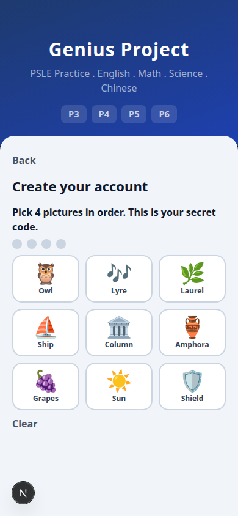

A 40-character nickname is rejected. On a 390px screen the preview string also shoves the stage-1 yarn ball off the right edge.

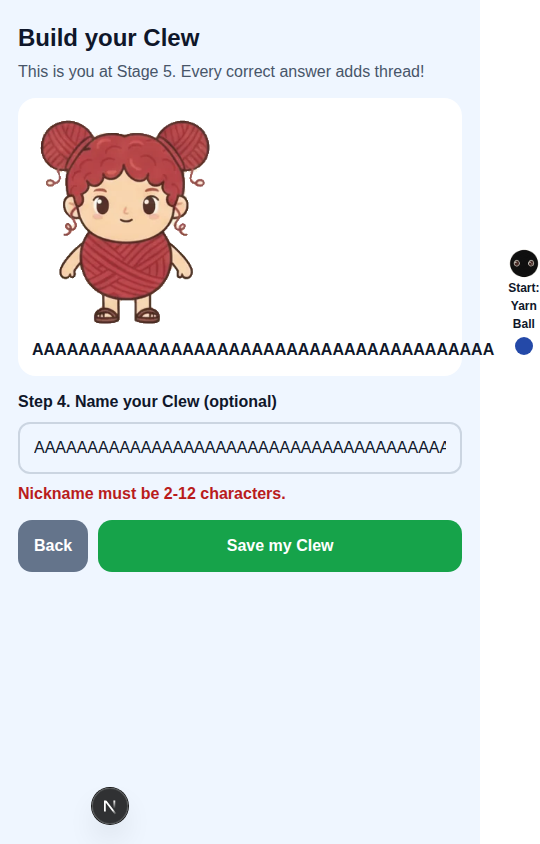

Landing at 390×844. The logo has a white fringe on the sea. "Coming soon" wraps so "soon)" sits on the next line. A solid navy band fills the rest of the phone.

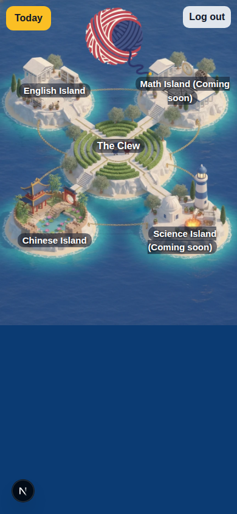

Stage 1 (0 thread), stage 2 (25), stage 4 (300, still crimson), stage 5 (700). At 10000 thread the home stays on stage 5.

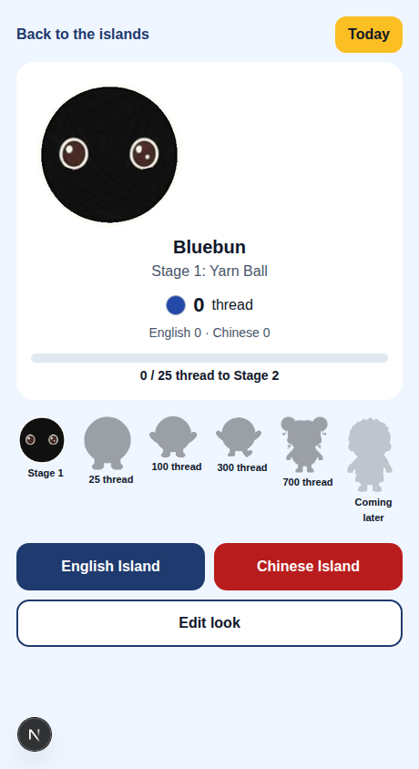

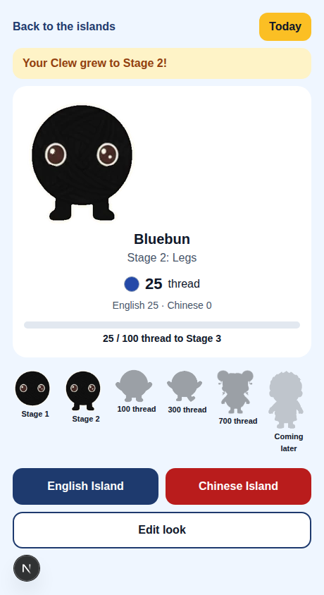

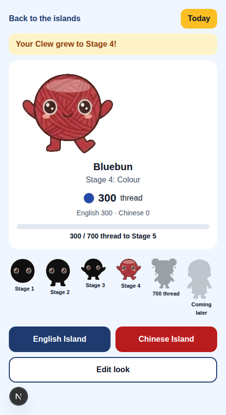

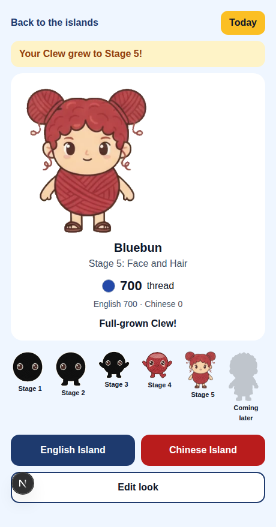

English question and marking. No character, no thread, no stage popup. The hint appears only after a wrong answer, then a retry.

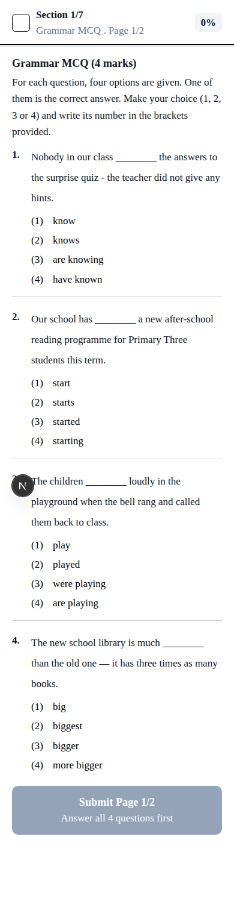

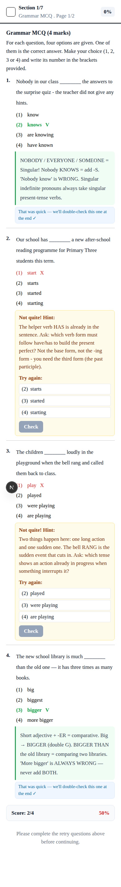

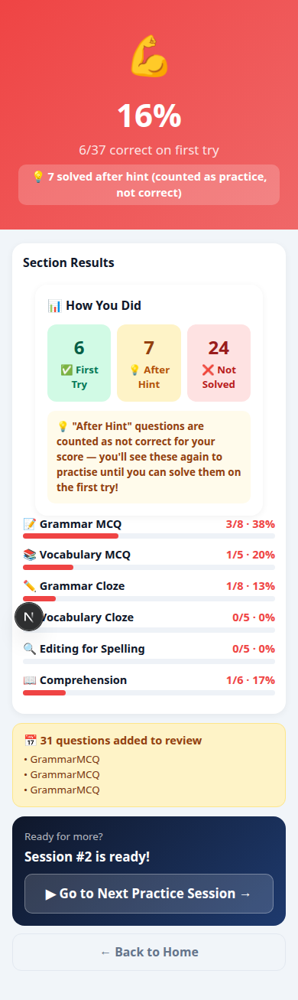

Chinese marking is the existing paper, including the English gloss inside the explanation. No ClewQuest chrome.

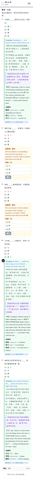

A parent-created password student lands here, with no Log out.

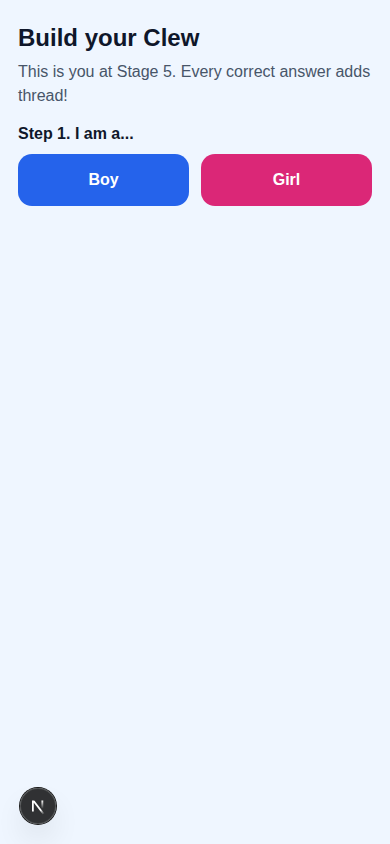

After saving a look, Today is the existing hub: daily target, English, Chinese, Mathematics and Science coming soon, stickers, no S$.

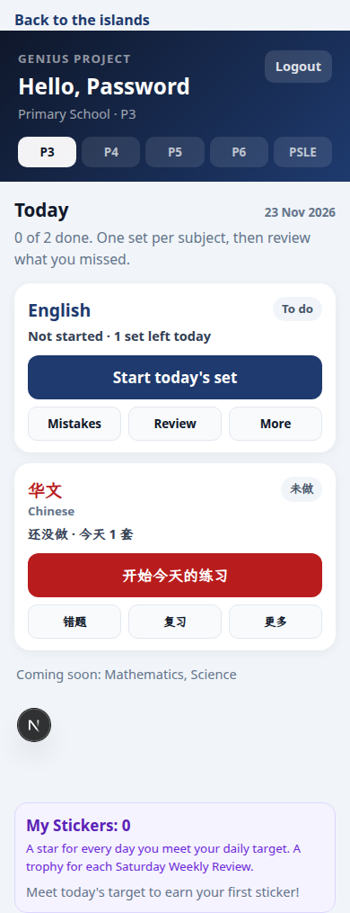

Parent settings after a reset. Daily targets and homework count are still there. The new card says the picture code was saved.

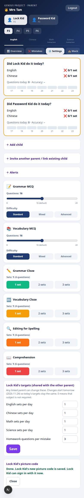

Flag off, production build. No picture buttons. Demo student is the plain Today hub, with no "Back to the islands".

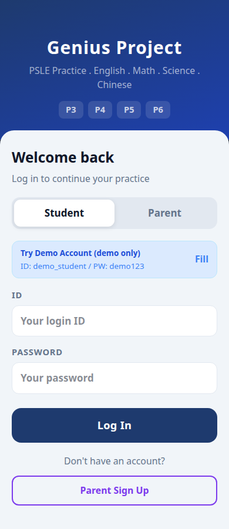

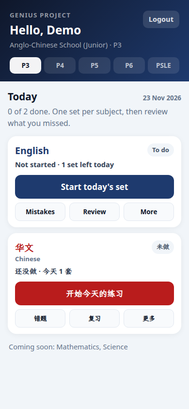

## Blocking

1. **A parent cannot take on a picture-code child.** "Link an existing child" asks for the child's password. The picture code is an HMAC on the server, so the parent has nothing to type. The form returns "wrong child username or password." Picture sign-up does not create a `parent_child` row. Reset itself works: once a link exists, Settings → Reset picture code replaces the code, clears the lock, and the new code signs in. An unlinked parent gets HTTP 403 and no card. The lock screen tells the child to ask a parent, and that parent cannot get there.

2. **A server password student does not keep the Today hub as home.** `demo_student` / `demo123` still opens the old hub, because that login never creates a server id. A child created by a parent (username + password, already linked) is a real server student. With the flag on, login opens "Build your Clew" and there is no Log out and no skip. The Today hub is only available after a character is saved, from the Today button. That fails the "existing password-login student keeps the Today hub" check for every server account.

## Non-blocking

- **White yarn edge.** The logo on the dark sea, and the stage 1–3 cut-outs, have a light fringe. The spec already lists edge fringes. It is obvious on the landing. Severity: medium.
- **Coming-soon labels wrap** inside the chip ("Math Island (Coming" / "soon)"). Severity: medium.
- **Navy band** under the map on a 390×844 screen. The art does not fill the phone. Severity: low.
- **Stage 4 and 5 stay crimson** when the chosen colour is Egyptian Blue. The blue shows as the small dot and the progress is grey. The spec allows a crimson fallback until recoloured art exists. Severity: low.
- **Nickname field.** A genuine 40-character value is rejected. Ordinary typing is silently cut to 12, and those 12 characters can be saved. The overflow preview only appears if the 40-character value is forced into the field. Severity: low.
- **Lock timing.** Five wrong codes still say "try again." The lock text is the next attempt. That matches the migration comment (the 6th attempt locks). Severity: low.
- **Student Sign Up is hidden** while server auth is on. Picture sign-up is the self-serve path; parents create password children. This is not new with ClewQuest, and the flag-off build behaves the same. Severity: low.
- **Lyre** is the musical-notes character, labelled Lyre. Severity: low.
- **"Coming later"** uses the stage-6 boy drawing as a dark silhouette, including for a girl. It is not offered as a stage. Severity: low.
- The first shipped e2e could not finish comprehension until this PR taught the driver to tap order cards. That was the harness, not the paper. The paper completed once the driver tapped the cards.

## What was checked and what was not

Checked in the browser: picture sign-up and labels, lockout, builder, island hit targets, Today and back, leaving a subject, English and Chinese ExamSession awards, stage art through the cap, demo login, parent-created password login, parent settings and picture reset, unlinked 403, flag-off build.

Not checked: a full parent rewards payout, assigning homework and solving it, Saturday stickers, or a second device. The sticker shelf rendered "My Stickers: 0" with no dollar amount. Wallet rows stay hidden until a credit exists, which matches the credits-only student wallet. No email or WhatsApp was sent.
