# ClewQuest Phase 1 role-play recheck — 23 Nov 2026

Recheck of ClewQuest Phase 1 on current `main` (`3749178`, PR #78), which fixes the two blockers in [docs/e2e-clewquest-phase1-2026-11-23.md](e2e-clewquest-phase1-2026-11-23.md). Same local harness, extended for the link-code, lockout, and Today-hub checks. Target launch 27 Nov 2026 SGT.

**Launch-ready: yes.**

The two previous blockers are fixed in the UI. A picture-code child can hand a parent a one-time 6-digit code, and that parent links the child with username plus code. A parent-created password student lands on the Today hub and opens ClewQuest only by choice. No new blocker turned up.

Nothing in this run contacted the production project `zehnulwvysvnsshunxzr`. Email and WhatsApp were left unset. The picture-code pepper was a random local value and is not recorded here.

## Environment

| Item | Value |
|---|---|
| Git | `3749178` on `main` (PR #78). This branch adds the recheck report and harness only. |
| Supabase | CLI 3.3.0, `supabase start` on `http://127.0.0.1:54321` (studio, storage, realtime and the other excluded services left stopped) |
| Migrations | All 17 files in `supabase/migrations/`, in filename order, through `20261203000000_clewquest_phase1.sql` and `20261204000000_clewquest_link_codes.sql`. Confirmed in `supabase_migrations.schema_migrations`. `supabase status` did not contain the production ref. `seed.sql` is listed in config and is not in the repo; start warned and still finished. |
| App, flag on | `next dev` with `NEXT_PUBLIC_SERVER_AUTH=true`, `NEXT_PUBLIC_CLEWQUEST_ENABLED=true`, plus homework, wrong-answer sync and rewards flags. `EMAIL_ALERTS_ENABLED` and `WHATSAPP_ENABLED` empty. |
| App, flag off | Production `npm run build` (exit 0) then `next start`, same local Supabase, ClewQuest flag unset. |
| Viewport | Role-play and flag-off at 390×844. `npm run e2e:clewquest` uses the shipped 1280×900 viewport. |
| Browser | Playwright Chromium. Picture glyphs also checked with Noto Color Emoji installed. |

## Automated counts

`npm run selftest` exit 0. `npm run typecheck` exit 0 (`tsc --noEmit`, no errors).

| Suite | Result |
|---|---|
| `no_korean_selftest` | 389 pass / 0 fail (383 files, 0 Hangul lines) |
| `cloze_order_selftest` | 39 pass / 0 fail |
| `p3_reclass_selftest` | 576 pass / 0 fail |
| `exam_selftest` | 64 checks, all passed |
| `child_settings_selftest` | 17 pass |
| `daily_target_selftest` | 16 pass |
| `homework_mastery_selftest` | 21 pass |
| `pending_credits_selftest` | 14 pass |
| `rewards_tiers_selftest` | 46 pass |
| `notify_selftest` | 5 pass |
| `weekly_report_selftest` | 16 pass |
| `event_alerts_selftest` | 13 pass |
| `clewquest_selftest` | 279 pass, 0 fail |
| `zh_wa1_selftest` | 27 pass / 0 fail |
| **selftest total** | **1522 pass / 0 fail** |
| **typecheck** | **0 errors** |

`npm run e2e:clewquest`: **1 passed** (14.5s). Screenshots `cq-01` … `cq-05`.

Role-play harness `tests/e2e/clewquest-roleplay.spec.js`: **12 / 12 checks passed** (38.2s) on the final run.

Flag-off harness: **1 passed.** All 10 ClewQuest routes returned 404, including the new link-code and parent picture-child routes.

## Pass / fail

| Check | Result |
|---|---|
| Picture sign-up, label under every picture | Pass. Owl, Lyre, Laurel, Ship, Column, Amphora, Grapes, Sun, Shield. Glyphs rendered (no tofu). |
| Picture child gets a 6-digit code; parent links with username + code | Pass. The stored value is a 64-character HMAC, not the digits. The parent dashboard shows the child, and `parent_child` has that parent's row. |
| Wrong, reused, and expired codes | Pass. All three show the same sentence: "That code did not work. Ask your child for a new code." None of the messages say expired, reused, or unknown. |
| Parent creates a picture-code child | Pass. The child appears on the parent account immediately, with a `parent_child` row. No second link step. |
| Wrong picture code 5 times, lock on the 5th | Pass. Attempts 1–4 say "That did not work. Try again." Attempt 5 says "Locked for 15 minutes." and shows "Ask a parent to reset your picture code." |
| Lock screen does not show a link code | Pass. No 6-digit code and no link-code panel on the lock screen. |
| Linked parent resets with their own session; new code works immediately | Pass. Old code is rejected. New code opens the islands with no wait. |
| Unlinked parent cannot reset | Pass. No reset card. `POST /api/clewquest/picture-reset` returned 403. |
| Nickname 24 max, with a counter | Pass. Typing past 24 keeps 24 and the counter reads "24 / 24" in red. A forced 40-character value is rejected ("Nickname must be 2-24 characters."). "Bluebun" saves. |
| "(Coming soon)" on one line | Pass. Math Island and Science Island each show "(Coming soon)" as its own line. The phrase is not split. |
| No navy band filling the phone | Pass. On 390×844 the map ends, the link row sits under it, and 232px below that is white. The empty navy band from the previous report is gone. |
| Builder: boy/girl, 10 hairstyles, 6 colours | Pass. 5 boy tiles, 5 girl tiles, 6 named swatches. |
| Today on the landing and on the Clew home; leaving a subject returns | Pass. |
| English ExamSession: first try +1, hint then correct +0.5, wrong twice 0 | Pass. `english\|S01_B_S01_B1` = 1 `correct_first_try`; `english\|S01_B_S01_B2` = 0.5 `correct_after_hint`; `english\|S01_B_S01_B3` has no ledger row. |
| Same on Chinese | Pass. `chinese\|ZS01_A1` = 1; `chinese\|ZS01_A2` = 0.5; `chinese\|ZS01_A3` has no row. |
| Solve and marking screens have no ClewQuest UI | Pass. No `cq-` test id, no `/clewquest/` image, no thread counter on the question, the hint/retry marking, or the result screen. |
| Home stage art at 0 / 25 / 100 / 300 / 700 / 10000 thread | Pass. Stages 1, 2, 3, 4, 5, then still stage 5 ("Full-grown Clew!"). No "Stage 6/7/8" and no "thread to Stage 6". One "Coming later" silhouette. |
| No Korean | Pass on the screens the harness scanned. `no_korean_selftest` is 0 Hangul lines. |
| Demo password student (`demo_student`) keeps the Today hub | Pass. |
| Parent-created password student keeps the Today hub | Pass. Login opens Today, with "Open ClewQuest". The builder is not forced. |
| Builder has Skip for now and Log out | Pass. Skip returns the password student to Today. Log out returns to the login screen. |
| Flag off: routes 404, no picture buttons, demo Today hub, no islands | Pass. |

## Screens

The child reads a 6-digit code on the islands. The parent types the username and those digits.

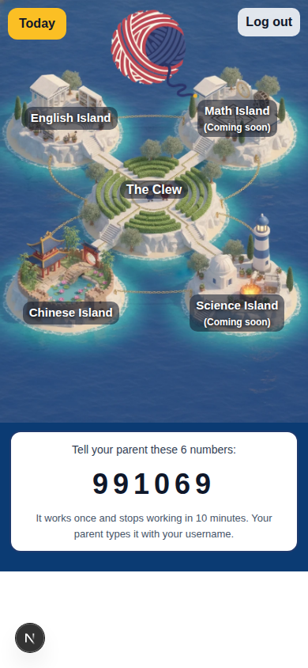

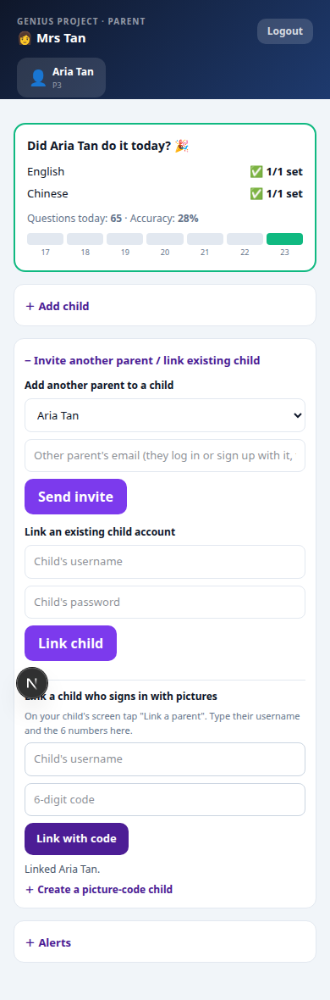

A wrong code, a reused code, and a code whose expiry was moved into the past all produce the same sentence.

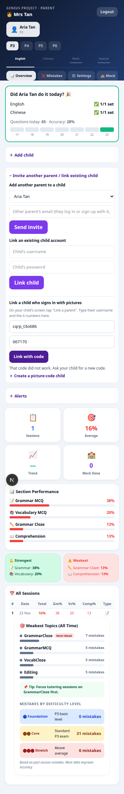

A picture-code child created from the parent account is already on the dashboard.

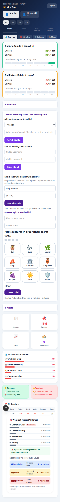

The fifth wrong code locks. The panel tells the child to ask a parent. It does not show a code. (The dark "N" on this `next dev` screenshot is the Next.js dev indicator, sitting on the first letters. The captured text starts "Ask a parent to reset your picture code." The production flag-off screenshots have no "N".)

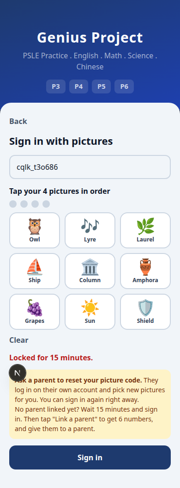

The linked parent sets a new code from their own Settings session. The child then signs in with it.

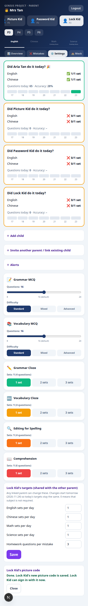

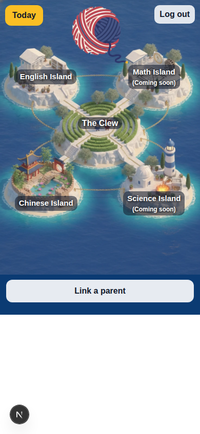

A parent-created password student opens the Today hub. "Open ClewQuest" is optional. The builder offers Skip for now and Log out.

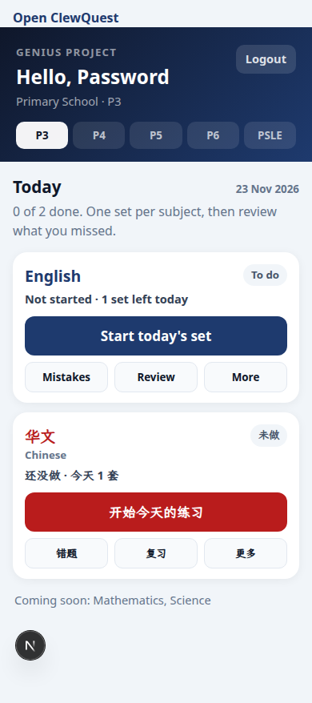

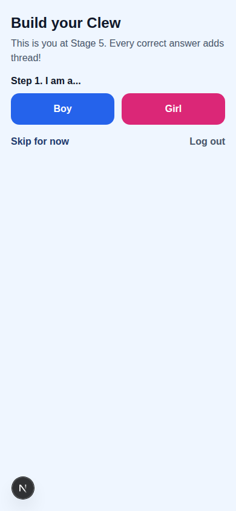

Nickname counter at 24, and "(Coming soon)" on one line. The rest of the phone under the map is white.

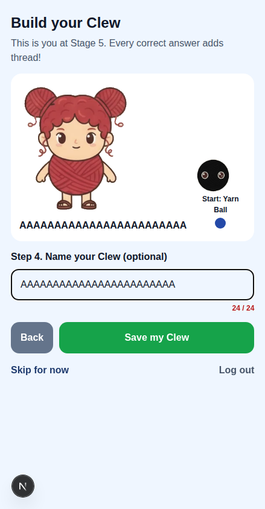

English and Chinese marking still have no character, thread, or stage popup.

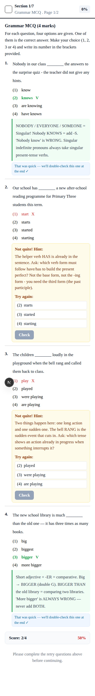

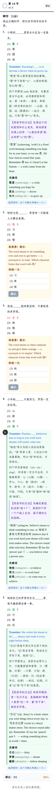

Stage 1 at 0 thread, stage 4 at 300 (art still crimson, blue dot), stage 5 at 700.

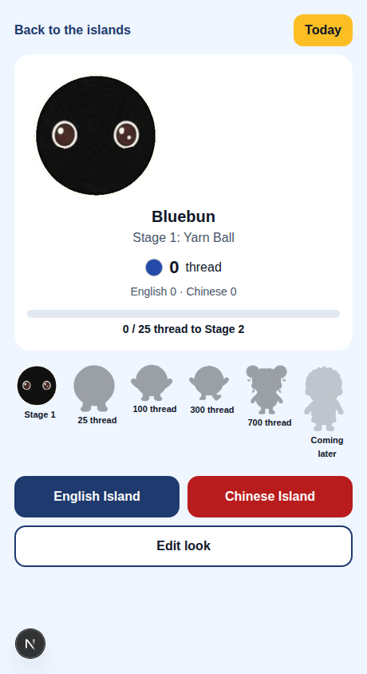

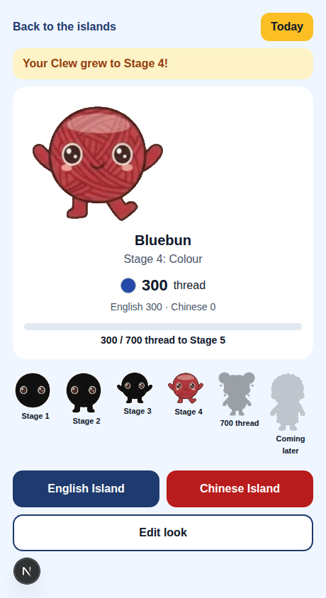

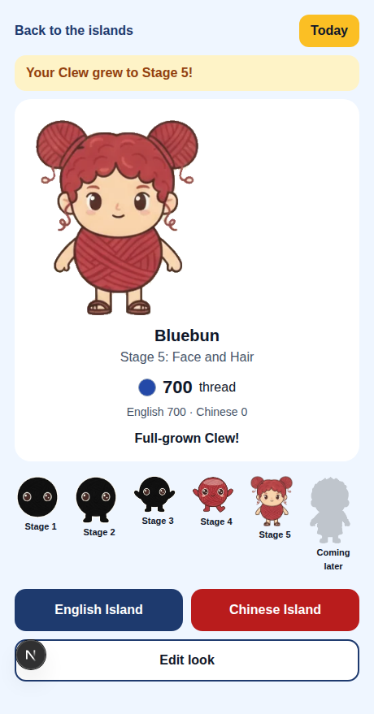

Flag off, production build. No picture buttons. Demo student is the plain Today hub.

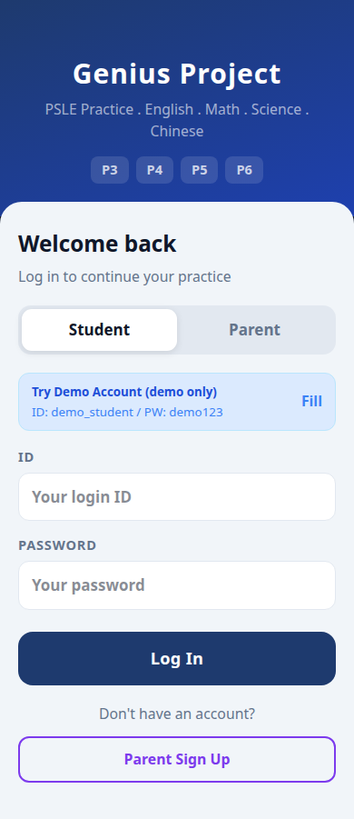

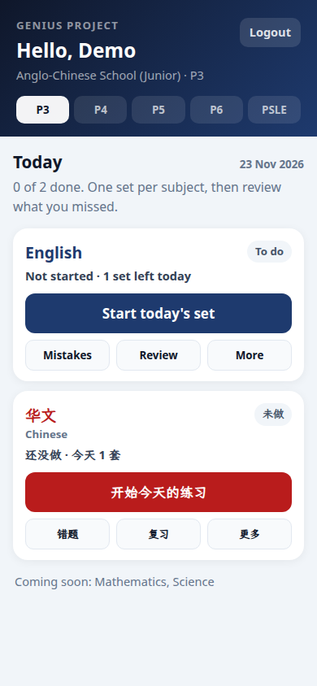

## Blocking

None.

## Non-blocking

- **White yarn edge.** The logo on the dark sea still has a light fringe. The spec already lists edge fringes. Severity: medium.
- **Stage 4 and 5 stay crimson** when the chosen colour is Egyptian Blue. The blue shows as the small dot, and the progress bar uses that blue. The spec allows a crimson fallback until recoloured art exists. Severity: low.
- **Lock copy always mentions the unlinked path.** After a parent is already linked, the 5th wrong code still adds "No parent linked yet? Wait 15 minutes…". The first lines are right: ask a parent, they pick new pictures, sign in again right away. No code is shown. Severity: low.
- **"Coming later"** wraps onto two short lines under the silhouette, and the silhouette is still the stage-6 boy drawing, including for a girl. It is not offered as a stage. Severity: low.
- **Lyre** is the musical-notes character, labelled Lyre. Severity: low.
- **Student Sign Up stays hidden** while server auth is on. Picture sign-up and parent-created children are the paths that were checked. This is unchanged from the previous report. Severity: low.

## What was checked and what was not

Checked in the browser: picture sign-up and labels, the 6-digit link code and parent redeem, wrong / reused / expired codes, a parent-created picture child already linked, five wrong codes and the lock text, parent reset from the linked parent's own session, immediate sign-in with the new code, unlinked 403, nickname counter, coming-soon lines, phone landing, builder, island hit targets, Today and back, leaving a subject, English and Chinese ExamSession awards, stage art through the cap, demo login, parent-created password login, Skip for now and Log out, flag-off build.

The first role-play attempt stopped while logging the parent out. The parent button says "Logout" and the harness only matched "Log out". By then the child was already linked and a reused code had been rejected. That was the harness. After the match was widened, the full role-play passed. Product code was not changed.

Not checked: a full parent rewards payout, assigning homework and solving it, Saturday stickers, or a second device. The parent Today card did show Aria's English and Chinese sets from this role-play (1/1 each). No email or WhatsApp was sent.
