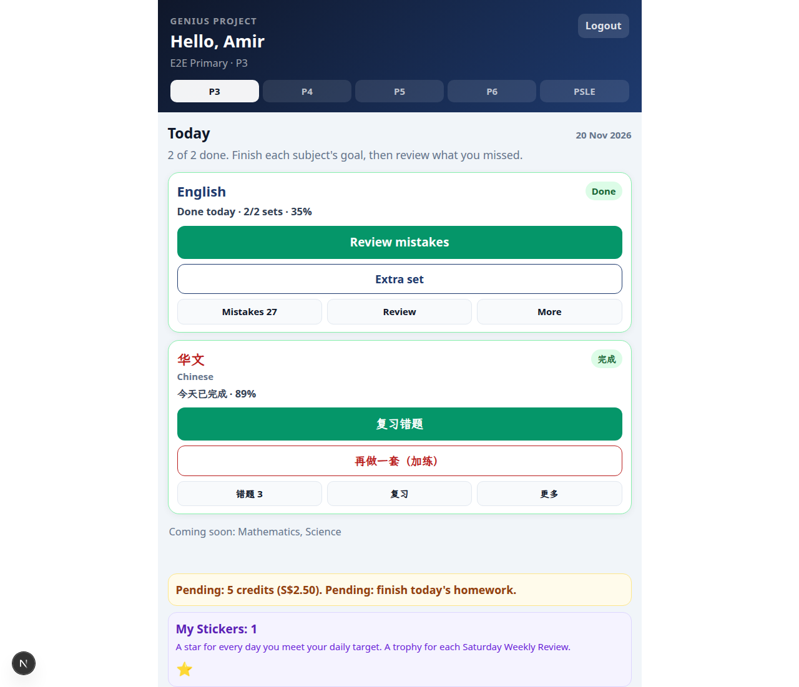
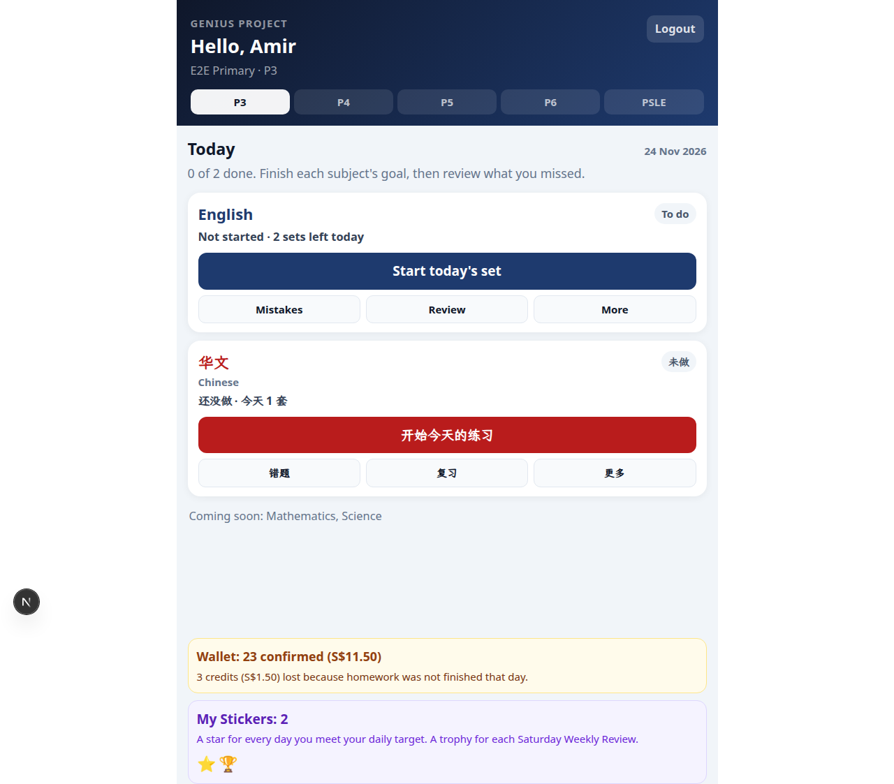

# Role-play report, 19 Nov 2026

Played as Mrs Tan, Mr Tan, and their child Amir on a local Supabase database after PR #33 (`20b88875` on `main`). `bash tools/e2e/run-roleplay.sh` exited 0: **34 pass, 0 fail, 1 gap**. Nothing in the run used the production project `zehnulwvysvnsshunxzr` or production Vercel. `EMAIL_ALERTS_ENABLED` and `WHATSAPP_ENABLED` stayed off, so no real email or WhatsApp was sent.

Math and Science are still Coming soon, so the three score bands are English 91%, Chinese 89%, and a later English set at 56%.

## How the days were played

The VM's clock jumps back to the real time within about two seconds of `date -s`, so the host clock was left alone. Each Singapore day was moved together in three places that the product actually reads:

- The Next.js process, via `tools/e2e/day-shift.cjs` (a whole-day offset read on every `Date.now()`).
- The browser, via an init script that shifts `Date` only. Timers are not mocked.
- `record_activity`, via a local-only table `e2e_clock` applied by the runner after `supabase db reset`. It is not a product migration.

Thursday 19 Nov is offset 0. Friday is +1, Saturday +2, Sunday +3, Monday +4, Tuesday +5. GoTrue keeps the real clock, so login cookies stay valid. The 8pm job is `GET /api/cron/daily-alert` on that Singapore date. The rendered email is appended to the dry-run log (`ALERT_DRY_RUN_LOG`). Mailpit is running locally and received nothing.

Accounts: `mrs.tan.e2e@example.com`, `mr.tan.e2e@example.com`, student `amir_e2e`. Reward rule: 90%+ = 3 credits, 80%+ = 2, below 80 = 0, S$0.50 per credit, Saturday S$5 English and S$4 Chinese. The rule is saved on Thursday and takes effect Friday.

## Steps

| Role | Step | Expected | Actual | Result | Screenshot |
|---|---|---|---|---|---|
| Parent A | Sign up and create the child | Mrs Tan has a linked child | Created `amir_e2e` | PASS | [01](e2e-2026-11-19/rp-01-child-created.png) |
| Parent B | Accept the invite | Both parents linked to Amir | `parent_child` has 2 rows | PASS | [03](e2e-2026-11-19/rp-03-both-parents.png) |
| Parent A | Tiers, rate, Saturday reward | 90%+ is 3, 80%+ is 2, below 80 is 0, S$0.50, Saturday S$5 / S$4, effective tomorrow | Version `2026-11-20`, rate 0.5, unit sgd, English 5, Chinese 4 | PASS | [04](e2e-2026-11-19/rp-04-rules-tomorrow.png) |
| Parent B | Edit the shared English target | Next SGT day, an audit row, parent A notified, no real email | Mr Tan, effective 2026-11-20; 2 dry-run emails | PASS | [05](e2e-2026-11-19/rp-05-parent-b-audit.png) |
| Student | Thursday target | English still 1 set | API English 1; screen shows 1 set left | PASS | [06](e2e-2026-11-19/rp-06-thursday-one-set.png) |
| Parent A | Thursday study status | English and Chinese not done | 0 sets, not done | PASS | [07](e2e-2026-11-19/rp-07-thursday-not-done.png) |
| System | 8pm alert, no study | Both parents get a dry-run "not done" email | HTTP 200, dryRun 2, both emails match | PASS | |
| Student | Friday target | English 2 sets, Chinese 1 | Server and browser 2026-11-20, English 2 | PASS | [08](e2e-2026-11-19/rp-08-friday-two-sets.png) |
| Student | English first set | 90%+ earns 3 credits, pending | 34/37 = 91%, 3 pending | PASS | [09](e2e-2026-11-19/rp-09-english-92.png) |
| Student | Second English set | First-try score and the one credit stay | sets 2, first set still 34/37, still 3 credits | PASS | [10](e2e-2026-11-19/rp-10-english-redo.png) |
| Student | Causes and Your patterns | Causes on the notebook, patterns list them | 25 cards tagged, Your patterns visible | PASS | [11](e2e-2026-11-19/rp-11-patterns.png) |
| Student | Try similar | A similar round can be finished | Finished and returned to the notebook | PASS | [12](e2e-2026-11-19/rp-12-similar.png) |
| Student | Chinese first set | 80–89% earns 2 credits, pending | 25/28 = 89%, 2 pending | PASS | [13](e2e-2026-11-19/rp-13-chinese-83.png) |
| Student | Wallet before homework | Pending credits and the SGD at S$0.50 | English 3 + Chinese 2 = S$2.50 on screen | PASS | [14](e2e-2026-11-19/rp-14-wallet-pending.png) |
| Parent A | Wrong questions and the cause | Mistakes tab shows the English cause | Cause label visible | PASS | [15](e2e-2026-11-19/rp-15-parent-causes.png) |
| Parent A | Default homework count | Box starts at 3 and assigns up to 3 | Box showed 3; 3 rows | PASS | [16](e2e-2026-11-19/rp-16-homework-default.png) |
| Parent A | More than 10 in a day | Not capped at 10 | 12 homework rows | PASS | [17](e2e-2026-11-19/rp-17-homework-over-10.png) |
| Parent A | Assign the same missed question | That question is homework today | Assigned 1 | PASS | |
| Student | Finish homework | Credits confirm and the wallet updates | 0 unsolved; English 3 and Chinese 2 confirmed; wallet S$2.50 | PASS | [18](e2e-2026-11-19/rp-18-homework-done.png) |
| Student | Same-question redo | No mastery for that question | 0 homework trials; mastery 16 → 16 | PASS | |
| Parent A | Mark a payout paid | Confirmed credits can be marked paid | 2 credits, S$1, note "Friday pocket money" | PASS | [19](e2e-2026-11-19/rp-19-payout.png) |
| Parent A | Learning dashboard | Mastery by skill, cause trends, improving or slipping, visible to both parents | Overview is a local session summary only | GAP | [20](e2e-2026-11-19/rp-20-overview.png) |
| Parent A | Friday study status | English 2/2 and Chinese 1/1 done | Both done | PASS | [21](e2e-2026-11-19/rp-21-friday-done.png) |
| System | 8pm alert, day studied | Both parents get a dry-run "all done" email | HTTP 200, 2 matching emails | PASS | |
| Student | Saturday weekly bonus | English 10 credits, Chinese 8, pending while Saturday is open | English 10 pending, Chinese 8 pending | PASS | [23](e2e-2026-11-19/rp-23-weekly-done.png) |
| Student | Saturday past-paper mock | Start and finish a past paper separate from today's set | Finished Nanyang Primary | PASS | [25](e2e-2026-11-19/rp-25-past-paper-done.png) |
| Student | Wallet after the bonus | Pending weekly credits with SGD | Pending 18 credits (S$9.00) | PASS | [26](e2e-2026-11-19/rp-26-saturday-wallet.png) |
| Student | Later English set around 60% | Below 80 earns nothing and does not rewrite Friday | Sunday first set 56%, 0 credit rows | PASS | [27](e2e-2026-11-19/rp-27-english-60.png) |
| Student | Sunday Chinese | The tier follows the first-try score | 50%, 0 credits | PASS | [28](e2e-2026-11-19/rp-28-sunday-chinese.png) |
| Student | Monday English | 90%+ earns 3 credits, still pending | 94%, 3 pending | PASS | [29](e2e-2026-11-19/rp-29-monday-pending.png) |
| Parent A | Leave Monday homework undone | The credit stays pending | Assigned 1; Pending still on screen | PASS | [29b](e2e-2026-11-19/rp-29b-monday-left-open.png) |
| Student | Day end forfeits that credit | Monday's 3 credits are forfeited and the wallet says so | English daily forfeited 3; lost line shown | PASS | [30](e2e-2026-11-19/rp-30-forfeited.png) |
| Student | Saturday after the day ended | No Saturday homework, so the weekly credits confirm | English confirmed, Chinese confirmed | PASS | |
| Student | Unseen similar question ≥ 1 day later | Same question adds nothing; the new one adds 0.5 | Mastery 32 → 32.5; same-question trials 0; weight 0.5 | PASS | [31](e2e-2026-11-19/rp-31-half-mastery.png) |
| Parent A | Study status across the week | The today card and 7-day strip are on the dashboard | Today card is there | PASS | [32](e2e-2026-11-19/rp-32-week-strip.png) |

Pending wallet before homework, at S$0.50:

Forfeited after Monday's homework was left undone:

## What a child or parent would trip over

- The student wallet did not show the dollar value of a credit. It now shows pending, confirmed, and forfeited amounts at the rate stored on each credit. The parent ledger shows the same for pending and forfeited rows.
- The pending line always says "Pending: finish today's homework", including on Saturday when the pending amount is the weekly bonus and no homework has been assigned. The credits are waiting because the day is still open.
- A past-paper "write your own word" cloze told the child to pick from a word box and then showed neither a box nor a place to type. Those blanks now have a text box, and a wrong answer can be retried by typing. Word-bank cloze is unchanged.
- Saturday's past paper is under More, then Extra practice. It is not on the Today card.
- Parent B's edit notifies parent A only by email. With email off, the dry-run is logged and nothing is sent. Inside the app, parent A sees it in the Settings change log, not as a notice on the dashboard.
- Reward and target edits always start tomorrow. A parent who turns credits on and expects today's practice to count will see no credit until the next Singapore day. The save message says that.
- There is no learning dashboard. The Overview tab is a session average, a last-3 trend, section bars, and a session table, read from this browser's history for one subject. It does not show mastery by skill, cause trends, or whether the child is improving, and the other parent does not see it from their own device.

Proposal for that gap: a Learning tab, the same for every linked parent, fed by the synced trials and wrong-answer causes. One line per subject: mastery now versus 7 days ago for each skill, a bar of causes over the last 14 days, and a single word — improving, flat, or slipping — from the first-try rate of the last 4 sessions compared with the 4 before.

## Fixes in this branch

- Student wallet and the parent pending/forfeited lines show the SGD amount.
- Open cloze without a word bank can be typed and retried.
- When `ALERT_DRY_RUN_LOG` is set, a disabled email channel appends the rendered subject and text. The address is not written. Nothing is sent.
