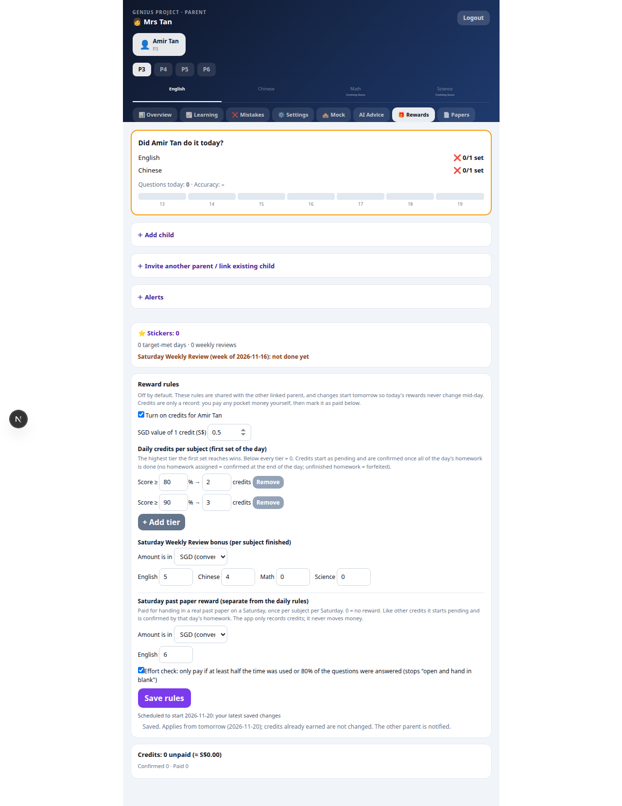
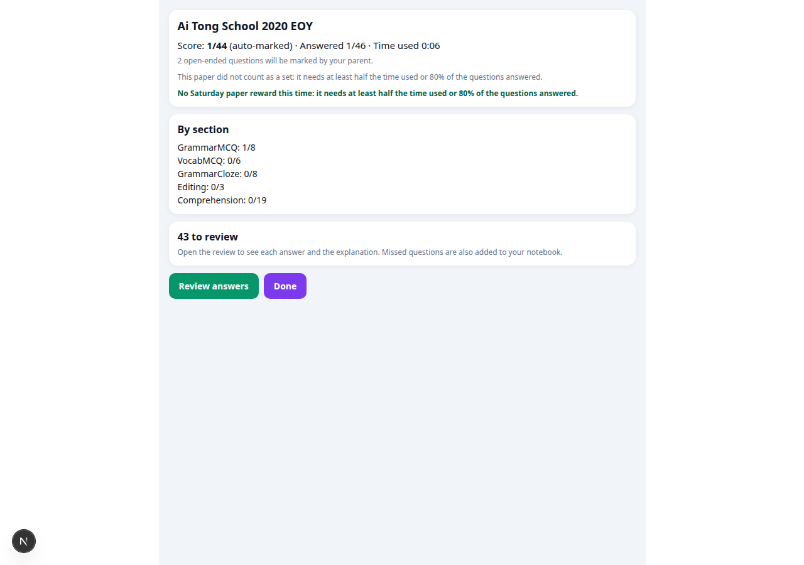
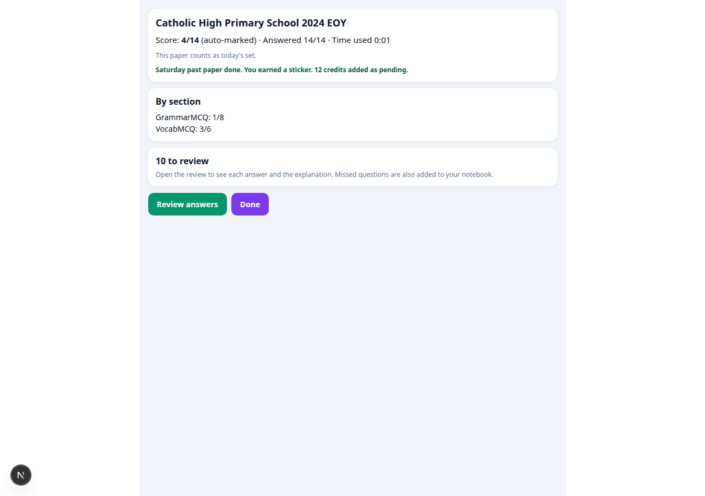
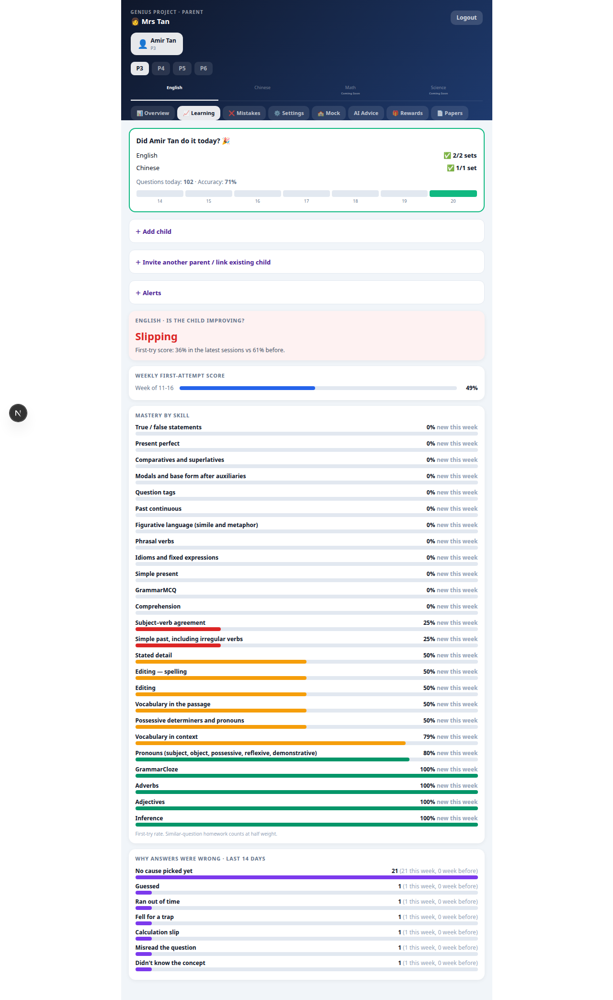

# Role-play report, 20 Nov 2026

Played on current `main` (`48565b2`, which includes PRs #45, #47, #49, #51 and #53) through the real UI in headless Chromium. The scripts click the same buttons a parent or student would, and every screen below is a full-page screenshot from that session.

Nothing in the run used the production Supabase project `zehnulwvysvnsshunxzr` or production Vercel. Local API was `http://127.0.0.1:54321`. `supabase start` then `supabase db reset` applied every file in `supabase/migrations`, in filename order, through `20261130000000_paper_rewards.sql`. `EMAIL_ALERTS_ENABLED` and `WHATSAPP_ENABLED` were unset, so no email and no WhatsApp was sent. Mailpit was up locally and was not used as a sender.

Feature flags were set only on that local Next.js process: `NEXT_PUBLIC_SERVER_AUTH`, `NEXT_PUBLIC_WRONG_ANSWERS_SYNC_ENABLED`, `NEXT_PUBLIC_PARENT_HOMEWORK_ENABLED`, `NEXT_PUBLIC_REWARDS_ENABLED`, `NEXT_PUBLIC_LEARNING_DASHBOARD_ENABLED`, `NEXT_PUBLIC_MOCK_EXAMS_ENABLED`. Defaults in `src/lib/supabase/config.js` are unchanged. Homework and wrong-answer sync were also on, because the reward and notebook steps need them. They are not on in the repo.

The machine date is Friday 20 Nov 2026. The multi-day story anchors day 0 to Thursday 19 Nov (a local clock shift in the Next process, the browser `Date`, and a local-only `e2e_clock` table). The paper story saves rules on the real Friday and sits the papers on Saturday 21 Nov. GoTrue keeps the real clock, so login cookies stay valid.

Two local families, same names, because the paper script resets the database before it starts. Mrs Tan (`mrs.tan.e2e@example.com`), Mr Tan (`mr.tan.e2e@example.com`), child Amir (`amir_e2e`, school E2E Primary, so the picker does not prefer one school).

## What was actually run

| What | Result |
|---|---|
| Local Supabase, all 13 migrations, then the local day-shift SQL | Ran. API ready on 127.0.0.1. |
| `E2E_MOCK_EXAMS=true bash tools/e2e/run-roleplay.sh` with grep `@roleplay` | Ran in Chromium. Script exit 1. 36 steps it marked pass, 2 it marked fail. Both fails are the script, not the screen. See below. |
| Same runner, grep `@paper` (`tests/e2e/paperReward.spec.js`) | Ran in Chromium after a fresh `db reset`. Script exit 1 on one over-broad check. Every product step passed. First attempt aborted on auto-submit because the browser clock was not shifted; the harness was fixed and this is the re-run. |
| Local SQL after the paper sitting: `exam_attempts`, `reward_credits`, `daily_activity`, `wrong_answers` | Ran against 127.0.0.1 only. |
| `docs/design/mock-exams-v1.md`, `docs/launch-checklist.md`, `docs/e2e-report-mock-phase2-2026-11-20.md`, the exam route and `publicPaper` | Read. The phase-2 report's Playwright line was "not run". This report is the run. |
| Playwright `@mock` and `@autosave` specs | Not run. The paper script covers that ground on the current UI. |
| A hand-driven browser outside Playwright | Not done. The clicks are Playwright's. The screenshots are from those clicks, and they were looked at. |

The local day-shift SQL now copies `record_activity` and `record_paper_activity` from `20261129000000_exam_attempts.sql` and only changes the date line. The previous copy had dropped the rule that a paper's 0/0 placeholder does not become the first-set score.

## 1. Two parents, one child, shared settings

| Step | Result | What happened |
|---|---|---|
| Mrs Tan signs up and creates Amir | PASS | [rp-01](e2e-2026-11-20/rp-01-child-created.png) |
| Mr Tan accepts the invite | PASS | `parent_child` has 2 rows. [rp-03](e2e-2026-11-20/rp-03-both-parents.png) |
| Mrs Tan sets tiers, S$0.50, Saturday weekly S$5 / S$4 | PASS | Saved for Friday 20 Nov. 90% → 3 credits, 80% → 2, below 80 → 0. [rp-04](e2e-2026-11-20/rp-04-rules-tomorrow.png) |
| Same save includes the Saturday paper reward | PASS | English S$6, unit SGD, effort check on (`paper_check_off` false). |
| Mr Tan changes English from 1 set a day to 2 | PASS | Audit row, effective 20 Nov, his name on it. Two dry-run emails, no send. [rp-05](e2e-2026-11-20/rp-05-parent-b-audit.png) |
| Thursday target is still 1 | PASS | Server and the Today card. [rp-06](e2e-2026-11-20/rp-06-thursday-one-set.png) |
| Friday target is 2 English, 1 Chinese | PASS | [rp-08](e2e-2026-11-20/rp-08-friday-two-sets.png) |

The other parent is told only by email. With sending off, that email is the dry-run log. Inside the app, Mrs Tan sees the change in the Settings log, not as a notice on the dashboard.

## 2. Reward rules in detail

Configured on the Rewards tab, not by a direct database write.

- Daily credits from the first set: 90% or more → 3, 80% or more → 2, below 80 → 0.
- 1 credit = S$0.50.
- Saturday Weekly Review: S$5 English (10 credits) and S$4 Chinese (8 credits).
- Saturday past paper: S$6 English (12 credits). Effort check left on: at least half the time, or 80% of the questions the scorer counts.
- The save message says the change starts the next Singapore day. Thursday's target stayed 1 set. Friday's became 2.



## 3. Daily sets, first-try score, causes

| Step | Result | What happened |
|---|---|---|
| English first set | PASS | 34/37 = 91%. 3 credits, pending. [rp-09](e2e-2026-11-20/rp-09-english-92.png) |
| Second English set the same day | PASS | Sets become 2. First-set score stays 34/37. Still one credit of 3. |
| Six English cause labels, then Your patterns | PASS | All six labels were on the card: Didn't know the concept, Misread the question, Calculation slip, Fell for a trap, Ran out of time, Guessed. 25 cards tagged. [rp-11](e2e-2026-11-20/rp-11-patterns.png) |
| Try similar | PASS | A similar round finished and returned to the notebook. |
| Chinese first set | PASS | 25/28 = 89%. 2 credits, pending. [rp-13](e2e-2026-11-20/rp-13-chinese-83.png) |
| Sunday English around 60% | PASS | 56%. No credit. Friday's credit was not rewritten. |
| Sunday Chinese | PASS | 50%. No credit. |
| Monday English | PASS | 94%. 3 credits, pending. |

Mrs Tan's mistakes tab showed the cause labels the child had picked.

## 4. Homework, pending credits, forfeiture

| Step | Result | What happened |
|---|---|---|
| Wallet before homework | PASS | English 3 + Chinese 2 = S$2.50 pending. [rp-14](e2e-2026-11-20/rp-14-wallet-pending.png) |
| Default homework count | PASS | The box opened at 3. One mistake assigned 3 rows. |
| More than 10 in a day | PASS | The box was set to 12. 12 rows were stored. The safety limit is 100, not 10. |
| Same missed question also assigned | PASS | That redo is homework. It does not raise mastery. |
| Child finishes Friday's homework | PASS | 0 unsolved. Both daily credits become confirmed. Wallet shows S$2.50. |
| Monday homework left undone | PASS | 1 question assigned. The credit stays pending. |
| Next day | PASS | Monday's 3 credits are forfeited. The wallet says they were lost. Saturday's weekly credits, with no homework that day, are confirmed. [rp-30](e2e-2026-11-20/rp-30-forfeited.png) |
| Unseen similar question at least one day later | PASS | Same question adds 0. The new one adds 0.5. Mastery 32 → 32.5. |

## 5. Mock exam

Played as a second local family on Saturday 21 Nov, after the paper reward had been saved on Friday.

| Step | Result | What happened |
|---|---|---|
| Paper list | PASS | Timer rule on the cards. Flagged papers stay in, with a neutral note (answer key worked out from the questions, or the year may differ). [paper-03](e2e-2026-11-20/paper-03-list.png) |
| Timer | PASS | Ai Tong School 2020 EOY, card 75 min, countdown 75:00. [paper-04](e2e-2026-11-20/paper-04-timer.png) |
| Free navigation and flag | PASS | 5 sections. Moved forward and back. One question flagged. |
| Autosave | PASS | A draft row with `correct` null within a few seconds. |
| Second browser | PASS | Continue restored the saved answer. No local draft on that browser. |
| Short hand-in | PASS | Ai Tong 2020, score 1/44, 1 of 46 answered, 6 seconds. Did not count. No paper credit. The screen says why. [paper-08](e2e-2026-11-20/paper-08-too-little.png) |
| Auto-submit at 0:00 | PASS | Ai Tong 2025, status `auto_submitted`, 0 answered, did not count, still no paper credit. |
| Enough answers for the reward | PASS | Catholic High Primary School 2024 EOY. Score 4/14, answered 14/14, counted because of answers. 12 credits pending, one sticker. [paper-10](e2e-2026-11-20/paper-10-reward.png) |
| Review and notebook | PASS | All 6 cause labels. One saved as Calculation slip. Missed items are in `wrong_answers` with `attempt_key` `exam-<id>`. |
| Notebook cap | PASS | Queried after the run: 20, 20, 20 and 10 rows on the four sittings. The cap of 20 per paper held. |
| Mrs Tan marks an open-ended item | PASS | Model answer on the Papers tab. One `parent_correct` row. [paper-12](e2e-2026-11-20/paper-12-parent-mark.png) |
| Mr Tan sees the same papers | PASS | Score on his Papers tab. |
| Paper does not become the tier score | PASS | `daily_activity` for 21 Nov: 1 set, 14 questions, 4 correct, `first_set_questions` 0 and `first_set_correct` 0. |





The first paper script died at auto-submit. The browser `Date` was still on the real Friday while the server deadline was on Saturday, so the countdown read 1515:00 and never hit 0. That was the harness. The re-run, with the shift stored on the app origin, showed 75:00 and auto-submitted.

The old "Past-paper mock" under More → Extra practice was also played, on the multi-day family, and it finished a Nanyang grammar cloze. That is not the timed exam. See the gaps.

## 6. Wallet and payouts

| Step | Result | What happened |
|---|---|---|
| Friday, before homework | PASS | Pending S$2.50 at S$0.50. |
| Friday, after homework | PASS | Confirmed. Mrs Tan marked 2 credits, S$1, note "Friday pocket money". |
| Saturday weekly | PASS | Pending 18 credits, S$9.00, while the day was still open. |
| Tuesday after Monday was left open | PASS | Wallet: 23 confirmed (S$11.50), and "3 credits (S$1.50) lost because homework was not finished that day." |
| Saturday paper, before the day ended | PASS | Pending line includes S$6.00. [paper-14](e2e-2026-11-20/paper-14-wallet.png) |
| Sunday, no Saturday homework | PASS | The 12 paper credits are confirmed. |
| Mrs Tan marks them paid | PASS | 12 credits, S$6, note "Saturday paper". [paper-16](e2e-2026-11-20/paper-16-paid.png) |

The ledger is a record. The app does not move money.

## 7. Dashboard and the 8pm dry-run

| Step | Result | What happened |
|---|---|---|
| Thursday, nothing studied | PASS | English and Chinese 0/1, not done. |
| 8pm, that day | PASS | HTTP 200, dryRun 2. Both emails say not done, English 0/1 and Chinese 0/1. No send. |
| Friday after both subjects | PASS | English 2/2 and Chinese 1/1 done. [rp-21](e2e-2026-11-20/rp-21-friday-done.png) |
| 8pm, that day | PASS | HTTP 200, dryRun 2. Both emails say done, English 2/2 and Chinese 1/1. |
| Learning, Mrs Tan, Friday | PASS on the screen. The script marked FAIL. | 73 server-graded English trials, 25 skills, 7 cause rows, word Slipping (39% vs 61%). The headings are CSS uppercase, so the script's mixed-case search missed them. [rp-20](e2e-2026-11-20/rp-20-learning.png) |
| Learning, Mr Tan, after more days | PASS on the screen. The script marked FAIL. | 28 skills and 7 cause rows, word Slipping (42% vs 61%), weeks of 16 Nov (49%) and 23 Nov (56%). He looked after Sunday and Monday, so the counts are higher than Mrs Tan's Friday snapshot. Same tab, same child, current data. [rp-33](e2e-2026-11-20/rp-33-learning-parent-b.png) |
| Forged trial | PASS | Unknown item stores nothing. Direct insert with Amir's own login is 403. Stored rows are `server_graded`. |
| 8pm on the paper Saturday | PASS | HTTP 200. Dry-run to both parents. Subject "Not done yet today" because Chinese was not done. Body has the Mock papers block and no answer key. |

The paper day's dry-run body (addresses are not in the log):

```
NOT DONE YET today: Amir Tan – Chinese
✅ Done – English: 1/1 set
❌ Not done – Chinese: 0/1 set
Questions answered: 14 · Accuracy: 29% · Minutes: 1
Mock papers
Ai Tong School 2020 EOY: 1/44 (2%) · did not count as a set · 2 open-ended to mark
Ai Tong School 2025 EOY: 0/21 (0%) · did not count as a set
Catholic High Primary School 2024 EOY: 4/14 (29%)
Ai Tong School 2020 EOY: 0/44 (0%) · did not count as a set · 2 open-ended to mark
```

The link in the dry-run is `https://psle-app-vwx3.vercel.app/` because `APP_BASE_URL` was unset. That is the code's fallback. Nothing was sent.



## Answer key

The paper script's leak check failed: 23 of 39 `/api/student/exam` responses matched a regex that treats `answers`, `correctAnswer` and `explanation` as leaks. That regex is too broad.

- An in-progress GET returns the student's own draft under `answers`, so a second device can resume. That is not the key.
- The review after hand-in returns `correctAnswer` and `explanation`. The review screenshot shows them. That is the point of the review.
- `publicPaper` in `src/lib/examServer.js` copies a whitelist (stem, options, passage, blanks). It does not copy `answer`, `hints`, `solution` or `explanation`.
- The submit payload returns per-item `correct` true/false and the reward. It does not return the key text.

The filtered check (ignore review payloads, and ignore the draft field `answers`) was added after this run and was not re-run. The code above is what was read. The review screen itself was seen.

## Gaps (these are not passes)

1. **Two past-paper doors.** The Today card has "English mock papers" (timed, this reward, this notebook). More → Extra practice → Past-paper mock still opens the old untimed practice. On Saturday that finished a Nanyang grammar cloze and did not create an `exam_attempts` row. A child who looks under More does not sit the paper the parent configured, and does not earn the Saturday paper reward.

2. **The score is not the paper the child just sat.** Ai Tong 2020 is scored out of 44 and lists every section. Catholic High 2024 is scored 4/14, "Answered 14/14", and "By section" is only Grammar MCQ and Vocabulary MCQ. Cloze, editing and comprehension on that paper are missing from the score. Those items are the ones the audit already found with no usable options. The child can click the graded section in about a second (this run: 1 second, 14/14 answered) and the effort check pays, because 80% of the *scored* questions were answered. Half the clock is not required. Blank hand-in is blocked. Instant clicking of the short graded part is not.

3. **The other parent hears about a settings change only by email.** There is no in-app notice. With sending off, the dry-run is the only copy.

4. **The pending line always says "finish today's homework".** On Saturday that line was the weekly bonus, and no homework had been assigned. The credits were pending because the day was still open.

5. **The 8pm subject line says "Not done yet"** whenever any subject is short. On the paper Saturday, English was done (the paper counted as the one set) and the subject line still said not done, because Chinese was not. The body is right. The subject overstates it.

6. **"Slipping" on the first days.** With two English sets on Friday, the newer half was the deliberately weak second set, so the word was Slipping (39% vs 61%). By Tuesday it was 42% vs 61%. The rule is the one in `trendWord`. A parent can read a one-day dip as a trend.

## Fixes in this branch

No product code. The app's flag defaults, migrations, workflows and `genius_*` keys were not changed.

Test harness only:

- The local day-shift SQL follows the current `record_activity` / `record_paper_activity`, including the 0/0 paper placeholder.
- The multi-day script anchors day 0 to a Thursday, so it still means Thursday when the machine date is Friday.
- Screenshots for this run go to `docs/e2e-2026-11-20/` (`E2E_SHOTS_DIR`).
- The learning assertion is case-insensitive. Mr Tan's check no longer requires the same counts as Mrs Tan's earlier look.
- The paper script sets the browser day-shift on the app origin, and its key check no longer treats the review or the student's draft as a leak. That filtered check was not re-run.

## Proposed issues

1. One Saturday paper entry. Hide or relabel the old Past-paper mock once mock exams are on, and say on the Today card that the timed paper is what the Saturday reward is for.
2. The hand-in total and the score total should be the same set of questions. Items with no usable key should be out of both, or shown as "not in the score" before the child hands in.
3. An in-app line when the other parent changes a shared setting, so it does not depend on email being on.
4. Pending copy that matches the reason: homework still open, or the day is not over yet.
